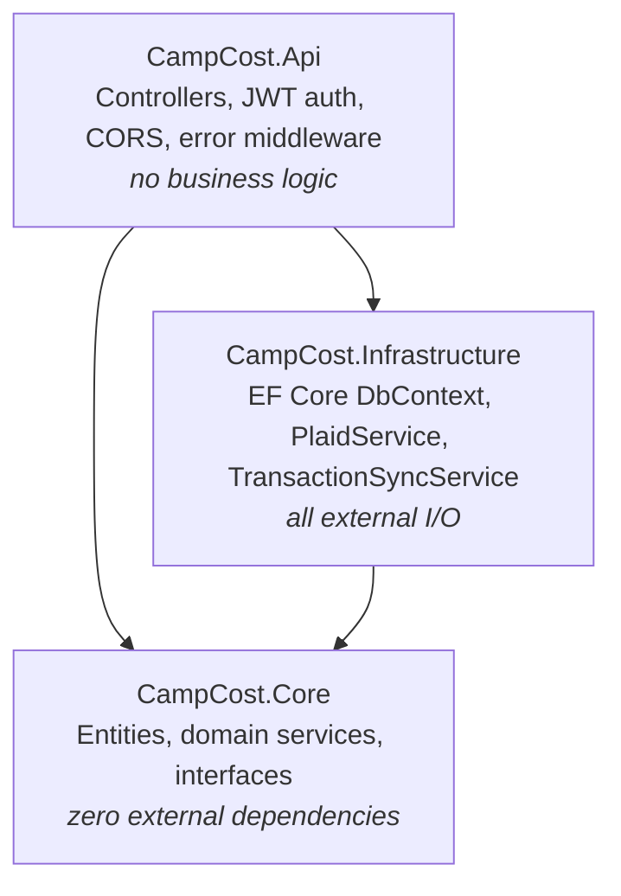

# CampCost

CampCost is trip budget tracking for RV and truck-camper travelers. It connects to your bank via Plaid, pulls in transactions automatically, categorizes them by merchant (Shell → fuel, KOA → campground), and matches each one to the right trip by date — so mid-trip you can see money left, daily burn rate, and an estimate of how many more days you can stay on the road.

ASP.NET Core 8 backend, React frontend, Supabase Postgres, deployed on Railway + Vercel.

## Tech Stack

| Layer | Technology | Why |
|---|---|---|
| API | ASP.NET Core 8 (LTS) | Strong typing for financial code, first-class async, built-in DI and JWT middleware. Upgraded from .NET 7 to stay on an LTS release. |
| Frontend | React 19 + Vite | Fast dev loop; the app is a small SPA (7 routes) so a full framework would be overkill. Tailwind 4 for styling, Recharts for budget charts, `react-plaid-link` for the bank-connection flow. |
| Database | Supabase (PostgreSQL) | Real Postgres with row-level security for any direct client access, plus hosted auth — no separate identity provider to run. |
| Auth | Supabase JWT (RS256) | The frontend signs in with Supabase; the API validates the same RS256 token against Supabase's JWKS endpoint. One identity system across both halves, no session state on the API. |
| Bank data | Plaid (Going.Plaid SDK) | Industry-standard transaction aggregation with a free sandbox. The SDK is isolated behind an interface so Plaid types never leak past the Infrastructure layer. |
| ORM | EF Core + Npgsql | Npgsql's enum mapping lets the C# code write directly to the `expense_category` Postgres enum instead of using text columns. |
| Hosting | Railway (API, Docker) + Vercel (frontend) | Railway runs the multi-stage Dockerfile; Vercel serves the static Vite build. Both configure everything through env vars. |

## Architecture

Clean Architecture with three projects and one dependency direction — inward:



- **Core** — entities (`Trip`, `Expense`, `PlaidConnection`, `BudgetCategory`, `TripStop`, `Subscription`), pure domain services (categorization, trip matching, budget math), and the `IPlaidService` / `ITransactionSyncService` interfaces. No EF Core, no Plaid, no HTTP. Every service here is unit-testable with plain objects — no mocks of infrastructure needed.
- **Infrastructure** — implements Core's interfaces: `CampCostDbContext` (EF Core → Supabase Postgres), `PlaidService` (wraps the Going.Plaid SDK and converts its types to a small `PlaidTransaction` DTO), and `TransactionSyncService` (the sync orchestrator). A single `AddInfrastructure()` extension wires the whole layer, so the Api project never references EF Core or Plaid directly.
- **Api** — two controllers (`TripController`, `PlaidController`), JWT bearer auth, config-driven CORS, and a global error-handling middleware. Controllers extract the user ID from the token, call a service, and return the result.

A deeper layer-by-layer walkthrough, including how a Plaid sync flows end to end, is in [docs/architecture.md](docs/architecture.md).

## Key Engineering Decisions

**Pending vs settled transactions.** Plaid gives a pending transaction a temporary ID, then a *different* permanent ID once it settles. Importing both creates a duplicate expense that dedup can't catch. Current approach: skip pending transactions entirely and only import settled ones, so only stable IDs ever enter the database. The full fix — migrating from `/transactions/get` to `/transactions/sync`, which reports added/modified/removed deltas and handles the ID swap natively — is planned and tracked.

**Deduplication by `plaid_transaction_id`.** A unique index on `(user_id, plaid_transaction_id)` (filtered to non-null IDs) makes it impossible to import the same bank transaction twice, even if a sync runs redundantly. Sync windows deliberately overlap (`last_sync_at - 2 days`) to catch late-posting transactions; the index makes that overlap safe.

**Deterministic trip matching.** Transactions match a trip when their date falls inside `[start_date - 2 days, min(end_date + 2 days, today)]`. Candidate trips are ordered by `StartDate` before matching, so when two trips overlap, the earliest-starting trip always wins — the assignment is reproducible, not dependent on query row order. Transactions matching no trip are **skipped**, never dumped into an arbitrary trip. A trip-scoped sync (`POST /api/plaid/sync?trip_id=...`) can later pull them in and even reassign transactions that landed on the wrong trip.

**Soft-delete only for financial history.** Expenses flagged during review are never hard-deleted. Skipped/removed items are recorded as `reviewed = true, adjusted_amount = 0, adjustment_note = 'skipped'`, so the audit trail of what the bank reported stays intact and budget totals remain explainable.

**`decimal` for all money.** Every monetary value — amounts, budgets, burn rates — is C# `decimal` mapped to Postgres `numeric`. No floats anywhere near money.

**Budget is always computed, never cached.** `BudgetCalculationService` recomputes planned budget, spend, burn rate, and days-left from source rows on every request. No stale cached totals to invalidate; if categories exist their planned amounts are summed, otherwise the trip's `total_budget` is the fallback.

## API Surface

All endpoints require a Supabase JWT Bearer token except the Plaid webhook.

| Method | Path | Description |
|---|---|---|
| `GET` | `/api/trips` | Current user's trips, ordered by start date |
| `GET` | `/api/trips/{id}/budget` | Planned budget, spent, money left, daily burn, days left |
| `GET` | `/api/trips/{id}/budget/by-category` | Planned vs actual per expense category |
| `POST` | `/api/plaid/link-token` | Create a Plaid Link token for the bank-connect UI |
| `POST` | `/api/plaid/exchange-token` | Swap public token for access token (upsert on `item_id`) |
| `POST` | `/api/plaid/sync` | Sync transactions; optional `?trip_id=` for trip-scoped sync |
| `POST` | `/api/plaid/webhook` | Plaid push webhook (TRANSACTIONS events) |

Swagger UI is served at `/swagger` with JWT Bearer support built in.

## Local Setup

### Prerequisites

- .NET 8 SDK
- Node.js 20+
- A Supabase project (run `client/supabase/migrations/001_init.sql` in the SQL editor)
- A Plaid developer account (sandbox is free)

### Backend

Secrets are loaded via `dotnet user-secrets` locally — nothing sensitive lives in `appsettings.json` or the repo.

```bash
dotnet restore

cd src/CampCost.Api
dotnet user-secrets set "ConnectionStrings:DefaultConnection" "Host=db.<project-ref>.supabase.co;Database=postgres;Username=postgres;Password=<your-db-password>"
dotnet user-secrets set "Supabase:Url" "https://<project-ref>.supabase.co"
dotnet user-secrets set "Plaid:ClientId" "<your-plaid-client-id>"
dotnet user-secrets set "Plaid:Secret" "<your-plaid-sandbox-secret>"
dotnet user-secrets set "Plaid:Environment" "sandbox"
dotnet user-secrets set "Plaid:WebhookUrl" "https://<your-public-url>/api/plaid/webhook"   # optional locally

cd ../..
dotnet run --project src/CampCost.Api
# API:     http://localhost:5033
# Swagger: http://localhost:5033/swagger
```

CORS defaults to `http://localhost:5173` / `5174` when `Cors:AllowedOrigins` is not configured, so the dev frontend works out of the box.

### Frontend

```bash
cd client
npm install

# .env.local (see client/.env.example for the full template)
# VITE_SUPABASE_URL=https://<project-ref>.supabase.co
# VITE_SUPABASE_ANON_KEY=<your-anon-key>
# VITE_API_URL=http://localhost:5033

npm run dev
# http://localhost:5173
```

### Testing protected endpoints in Swagger

Grab a JWT from the browser console while logged in to the frontend:

```js
(await supabase.auth.getSession()).data.session.access_token
```

Paste it into Swagger's **Authorize** dialog.

### Tests

```bash
dotnet test
```

Unit tests cover the three Core domain services: budget calculation, merchant categorization, and trip matching (including overlapping-trip and buffer-window edge cases).

## Deployment

| Piece | Platform | How |
|---|---|---|
| API | Railway | Builds the multi-stage `Dockerfile` (SDK image → `dotnet publish` → slim ASP.NET runtime image, listening on `:8080`). |
| Frontend | Vercel | Static Vite build from `client/`. |
| Database | Supabase | Managed Postgres + auth; RLS policies protect direct client access. |

Environment variables — **names only, set real values in each platform's dashboard**:

**Railway (API):**

| Variable | Purpose |
|---|---|
| `ConnectionStrings__DefaultConnection` | Supabase Postgres connection string |
| `Supabase__Url` | Supabase project URL (JWT authority = `{url}/auth/v1`) |
| `Plaid__ClientId` | Plaid client ID |
| `Plaid__Secret` | Plaid secret for the active environment |
| `Plaid__Environment` | `sandbox` \| `development` \| `production` |
| `Plaid__WebhookUrl` | Public URL Plaid POSTs transaction events to |
| `Plaid__RedirectUri` | OAuth redirect URI (only for OAuth-based banks) |
| `Cors__AllowedOrigins__0` | Frontend origin, e.g. `https://<your-app>.vercel.app` |

**Vercel (frontend):**

| Variable | Purpose |
|---|---|
| `VITE_API_URL` | Railway API base URL |
| `VITE_SUPABASE_URL` | Supabase project URL |
| `VITE_SUPABASE_ANON_KEY` | Supabase anon (public) key |

## Known Issues Before Go-Live

Tracked in `CLAUDE.md` with file/line detail. The critical ones:

1. **Webhook signature not validated** — the Plaid webhook endpoint accepts any POST; the `Plaid-Verification` JWT header must be verified before production.
2. **Webhook `SyncAllAsync` fallback** — an unknown `item_id` currently falls back to syncing every user; it should no-op instead.
3. **`ExchangeToken` connection lookup not scoped to the current user.**
4. **Null Plaid `TransactionId` falls back to a random GUID** in `PlaidService`, which would silently break dedup for that row.
5. **No pagination on `/transactions/get`** — truncates past 500 transactions per window.

## Project Layout

```
src/
  CampCost.Api/             ASP.NET Core host — controllers, middleware, Program.cs
  CampCost.Core/            Entities, domain services, interfaces (no external deps)
  CampCost.Infrastructure/  EF Core, Plaid SDK integration, sync orchestration
tests/
  CampCost.Tests/           xUnit tests for Core domain services
client/                     React + Vite SPA
  supabase/migrations/      Database schema + RLS policies
docs/                       Architecture deep-dive
Dockerfile                  Multi-stage build for the API (Railway)
```
