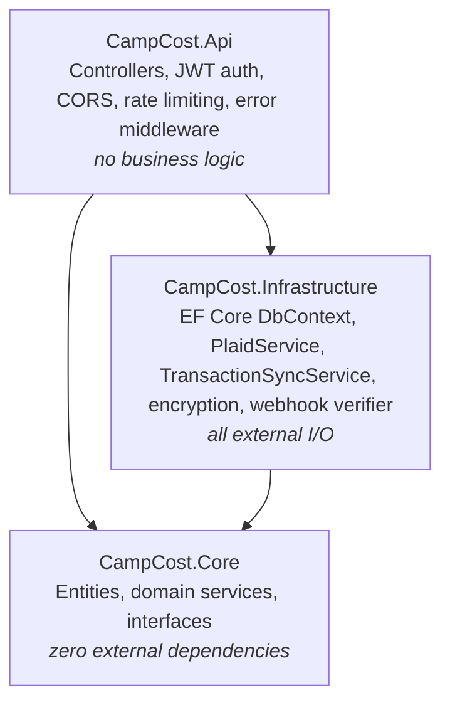

# CampCost

CampCost is trip budget tracking for RV and truck-camper travelers. It connects to your bank via Plaid, pulls in transactions automatically, categorizes them by merchant (Shell → fuel, KOA → campground), and matches each one to the right trip by date — so mid-trip you can see money left, daily burn rate, and an estimate of how many more days you can stay on the road.

**Live in production at [campcost.net](https://campcost.net)** — real Plaid production bank connections, live Stripe subscriptions, 215 passing tests. ASP.NET Core 8 backend, React frontend, Supabase Postgres, deployed on Railway.

## Tech Stack

| Layer | Technology | Why |
|---|---|---|
| API | ASP.NET Core 8 (LTS) | Strong typing for financial code, first-class async, built-in DI and JWT middleware. Upgraded from .NET 7 to stay on an LTS release. |
| Frontend | React 19 + Vite | Fast dev loop; the app is a small SPA so a full framework would be overkill. Tailwind 4 for styling, Recharts for budget charts, `react-plaid-link` for the bank-connection flow. |
| Database | Supabase (PostgreSQL) | Real Postgres with row-level security **and column-level grants** for direct client reads, plus hosted auth — no separate identity provider to run. |
| Auth | Supabase JWT (RS256) + TOTP MFA | The API validates the RS256 token against Supabase's JWKS with issuer **and** audience pinned. TOTP MFA (`aal2`) is required server-side before a bank can be connected. One identity system across both halves, no session state on the API. |
| Bank data | Plaid (Going.Plaid SDK), production | Cursor-based `/transactions/sync` ingestion. The SDK is isolated behind `IPlaidService` so Plaid types never leak past the Infrastructure layer. |
| Payments | Stripe | Free/Pro subscriptions via Checkout + a signature-verified webhook. Plan is the source of truth in a `subscriptions` table and is enforced server-side. |
| ORM | EF Core + Npgsql | LINQ over a Supabase-managed schema; `decimal` maps to Postgres `numeric` so no float ever touches money. |
| Hosting | Railway (Docker) | Multi-stage `Dockerfile` builds the API (`:8080`); Railway also serves the built Vite SPA. Everything is env-var driven. |
| Monitoring | Sentry + UptimeRobot | Backend error capture (PII off, errors only) + a DB-aware `/health` readiness probe so a database outage pages, not just a dead process. |

## Architecture

Clean Architecture with three projects and one dependency direction — inward:



- **Core** — entities (`Trip`, `Transaction`, `Expense`, `PlaidConnection`, `BudgetCategory`, `TripStop`, `Subscription`), pure domain services (categorization, trip matching, budget math, fuel estimation), and the `IPlaidService` / `ITransactionSyncService` interfaces. No EF Core, no Plaid, no HTTP — every service here is unit-testable with plain objects. `Transaction` is the raw Plaid mirror and source of truth for bank spend; `Expense` is manual entries only.
- **Infrastructure** — implements Core's interfaces: `CampCostDbContext` (EF Core → Supabase Postgres), `PlaidService` (wraps the Going.Plaid SDK and converts its types to a small `PlaidTransaction` DTO), `TransactionSyncService` (the sync orchestrator), plus AES-256-GCM token encryption (`AesGcmTokenProtector`) and Plaid webhook signature verification (`PlaidWebhookVerifier`). A single `AddInfrastructure()` extension wires the layer, so the Api project never references EF Core or Plaid directly.
- **Api** — five controllers (`TripController`, `PlaidController`, `TransactionController`, `AccountController`, `BillingController`), JWT bearer auth, config-driven CORS, per-user/per-IP rate limiting, and a global error-handling middleware. Controllers extract the user ID from the token, call a service, and return the result.

A deeper layer-by-layer walkthrough, including how a Plaid sync flows end to end, is in [docs/architecture.md](docs/architecture.md).

## Key Engineering Decisions

**Cursor-based transaction sync.** Ingestion uses Plaid's `/transactions/sync` (added/modified/removed deltas), not `/transactions/get`. Pending transactions **are** imported; when one settles, Plaid re-issues it with a new ID plus a `pending_transaction_id` pointing at the pending version — the sync updates the existing row **in place** (swapping the Plaid ID) so a pending and its settled copy never coexist. The cursor is persisted per connection in the *same* `SaveChanges` as the applied deltas, so it can never advance past data that wasn't stored.

**Transactions are the source of truth, decoupled from trips.** Every synced delta lands in a `transactions` table regardless of whether a trip claims it; `trip_id` stays `NULL` until a trip's date window matches (or the user assigns it manually). Nothing is ever skipped past the cursor — the old "unmatched transaction lost forever" failure mode is gone by construction, and unassigned rows are claimed later by a trip-scoped sync.

**Deduplication + concurrency safety.** A global unique index on `plaid_transaction_id` makes re-importing the same bank transaction impossible, even if a sync runs redundantly — and soft-deleted rows still block re-import (dedup lookups ignore the soft-delete query filter). Sync windows deliberately overlap to catch late-posting transactions; the index makes that safe. Concurrent syncs for the same user (a Plaid webhook burst, or a webhook racing a manual sync) are **serialized per user**, so two overlapping runs can't both pass the read-then-insert dedup and collide on the unique constraint.

**Deterministic trip matching.** Transactions match a trip when their date falls inside `[start_date - 2 days, min(end_date + 2 days, today)]`. Candidate trips are ordered by `StartDate` before matching, so when two trips overlap the earliest-starting trip always wins — reproducible, not dependent on query row order. Transactions matching no trip are **stored unassigned** (`trip_id NULL`), never lost and never dumped into an arbitrary trip; a trip-scoped sync (`POST /api/plaid/sync?trip_id=...`) pulls them in later and can reassign transactions that landed on the wrong trip.

**Soft-delete only for financial history.** Rows flagged during review are never hard-deleted. Skipped/removed items are recorded (`reviewed = true, adjusted_amount = 0, adjustment_note = 'skipped'` for skips; `deleted_at` for Plaid `removed` deltas), so the audit trail of what the bank reported stays intact and budget totals remain explainable. Only full account deletion purges history.

**`decimal` for all money.** Every monetary value — amounts, budgets, burn rates — is C# `decimal` mapped to Postgres `numeric`. No floats anywhere near money.

**Budget is always computed, never cached.** `BudgetCalculationService` recomputes planned budget, spend, burn rate, and days-left from source rows on every request. No stale cached totals to invalidate; if categories exist their planned amounts are summed, otherwise the trip's `total_budget` is the fallback.

## Security

Banking and user financial data is the core asset, so it's locked down before anything else:

- **Plaid access tokens encrypted at rest** — AES-256-GCM (`AesGcmTokenProtector`); the key comes from an env var, never the repo.
- **Webhooks verified before processing** — the `Plaid-Verification` ES256 JWT is checked (signature + `request_body_sha256` body hash + `iat` freshness) or the request is rejected `401`. An unknown `item_id` no-ops; there is no reachable "sync all users" path.
- **JWT issuer + audience pinned** to the Supabase project — a token from any other project or with a non-user audience is rejected.
- **MFA gate** — TOTP `aal2` is required server-side (not just in the UI) before `exchange-token` will connect a bank.
- **Rate limiting** — 10 req/min per user on `/api/plaid/*`, 30 req/min per IP on the webhook.
- **RLS + column grants** — the browser can read its own `transactions` but can never `SELECT` access tokens, item IDs, or sync cursors from `plaid_connections`.
- **Server-side plan enforcement** — Free/Pro limits are checked off the JWT; the client `plan` value is a display cache only, never trusted.

## API Surface

All endpoints require a Supabase JWT Bearer token except the Plaid webhook (signature-verified instead).

| Method | Path | Description |
|---|---|---|
| `GET` | `/api/trips` | Current user's trips, ordered by start date |
| `POST` | `/api/trips` | Create a trip (accepts budget categories + total miles) |
| `PUT` | `/api/trips/{id}` | Update a trip (date changes are plan-gated) |
| `DELETE` | `/api/trips/{id}` | Delete a trip |
| `GET` | `/api/trips/{id}/budget` | Planned budget, spent, money left, daily burn, days left |
| `GET` | `/api/trips/{id}/budget/by-category` | Planned vs actual per expense category |
| `PATCH` | `/api/trips/{id}/budget/{category}` | Edit a category's planned amount (requires a change note) |
| `POST` | `/api/trips/{id}/fuel-estimate` | Estimate trip fuel cost from miles + state gas prices |
| `POST` | `/api/plaid/link-token` | Create a Plaid Link token for the bank-connect UI |
| `POST` | `/api/plaid/update-link-token` | Create an update-mode Link token to re-authenticate an existing bank in place |
| `POST` | `/api/plaid/exchange-token` | Swap public token for access token (MFA-gated; upsert on `item_id`) |
| `POST` | `/api/plaid/sync` | Sync transactions; optional `?trip_id=` for trip-scoped sync |
| `POST` | `/api/plaid/reset-cursor` | Clear the sync cursor so the next sync re-pulls full history (never deletes) |
| `POST` | `/api/plaid/disconnect` | Disconnect a bank — revokes the Plaid item and detaches its history |
| `POST` | `/api/plaid/webhook` | Plaid push webhook (`TRANSACTIONS` + `ITEM` events), ES256-verified |
| `GET` | `/api/transactions/unassigned` | Review queue of unassigned transactions |
| `PATCH` | `/api/transactions/{id}/assign` | Assign/unassign a transaction to a trip |
| `PATCH` | `/api/transactions/{id}/adjust` | Adjust amount (split costs / reimbursements) |
| `DELETE` | `/api/transactions/{id}` | Soft-delete a transaction |
| `GET` | `/api/account/plan` | Current subscription plan |
| `DELETE` | `/api/account` | Delete the account and all associated data |
| `POST` | `/api/billing/checkout` | Create a Stripe Checkout session for Pro |
| `POST` | `/api/billing/cancel` | Cancel the active subscription |
| `POST` | `/api/billing/webhook` | Stripe webhook (subscription lifecycle), signature-verified |

Swagger UI is served at `/swagger` (Development only) with JWT Bearer support built in.

## Local Setup

### Prerequisites

- .NET 8 SDK
- Node.js 20+
- A Supabase project — run the migrations in `client/supabase/migrations/` in order (`001` → `012`) in the SQL editor
- A Plaid developer account (sandbox is free)

### Backend

Secrets are loaded via `dotnet user-secrets` locally — nothing sensitive lives in `appsettings.json` or the repo.

```bash
dotnet restore

cd src/CampCost.Api
dotnet user-secrets set "ConnectionStrings:DefaultConnection" "Host=db.<project-ref>.supabase.co;Database=postgres;Username=postgres;Password=<your-db-password>"
dotnet user-secrets set "Supabase:Url" "https://<project-ref>.supabase.co"
dotnet user-secrets set "Plaid:ClientId" "<your-plaid-client-id>"
dotnet user-secrets set "Plaid:Secret" "<your-plaid-sandbox-secret>"
dotnet user-secrets set "Plaid:Environment" "sandbox"
dotnet user-secrets set "Plaid:WebhookUrl" "https://<your-public-url>/api/plaid/webhook"   # optional locally
dotnet user-secrets set "Encryption:TokenKey" "<base64 of 32 random bytes: openssl rand -base64 32>"
dotnet user-secrets set "Stripe:SecretKey" "<your-stripe-test-secret>"                       # optional locally
dotnet user-secrets set "Stripe:WebhookSecret" "<from `stripe listen`>"                       # optional locally
dotnet user-secrets set "Stripe:PriceId" "<your-pro-price-id>"                                 # optional locally

cd ../..
dotnet run --project src/CampCost.Api
# API:     http://localhost:5033
# Swagger: http://localhost:5033/swagger
```

CORS defaults to `http://localhost:5173` / `5174` when `Cors:AllowedOrigins` is not configured, so the dev frontend works out of the box.

### Frontend

```bash
cd client
npm install

# .env.local (see client/.env.example for the full template)
# VITE_SUPABASE_URL=https://<project-ref>.supabase.co
# VITE_SUPABASE_ANON_KEY=<your-anon-key>
# VITE_API_URL=http://localhost:5033

npm run dev
# http://localhost:5173
```

### Testing protected endpoints in Swagger

Grab a JWT from the browser console while logged in to the frontend:

```js
(await supabase.auth.getSession()).data.session.access_token
```

Paste it into Swagger's **Authorize** dialog.

### Tests

```bash
dotnet test
```

215 tests spanning the Core domain services (budget calculation, merchant categorization, trip matching, fuel estimation), the controllers (plan gating, the MFA gate, webhook signature verification, update-mode re-auth), and the Plaid sync pipeline (dedup, pending→settled reconciliation, soft-delete, cross-reconnect reclaim, and concurrent-sync serialization).

## Deployment

| Piece | Platform | How |
|---|---|---|
| API | Railway | Builds the multi-stage `Dockerfile` (SDK image → `dotnet publish` → slim ASP.NET runtime image, listening on `:8080`). |
| Frontend | Railway | Serves the static Vite build from `client/` (`VITE_*` vars are baked in at build time). |
| Database | Supabase | Managed Postgres + auth; RLS + column grants protect direct client access. |

Environment variables — **names only, set real values in each platform's dashboard**:

**Railway (API):**

| Variable | Purpose |
|---|---|
| `ConnectionStrings__DefaultConnection` | Supabase Postgres connection string |
| `Supabase__Url` | Supabase project URL (JWT authority = `{url}/auth/v1`) |
| `Encryption__TokenKey` | Base64 AES-256 key for encrypting Plaid access tokens at rest |
| `Plaid__ClientId` | Plaid client ID |
| `Plaid__Secret` | Plaid secret for the active environment |
| `Plaid__Environment` | `sandbox` \| `development` \| `production` |
| `Plaid__WebhookUrl` | Public URL Plaid POSTs transaction/item events to |
| `Plaid__RedirectUri` | OAuth redirect URI (only for OAuth-based banks) |
| `Stripe__SecretKey` | Stripe secret key |
| `Stripe__WebhookSecret` | Stripe webhook signing secret |
| `Stripe__PriceId` | Stripe price ID for the Pro plan |
| `Stripe__ClientUrl` | Base URL Checkout redirects back to |
| `Cors__AllowedOrigins__0` | Frontend origin, e.g. `https://campcost.net` |
| `Sentry__Dsn` | Sentry ingest DSN (optional; empty disables error reporting) |

**Railway (frontend build):**

| Variable | Purpose |
|---|---|
| `VITE_API_URL` | Railway API base URL |
| `VITE_SUPABASE_URL` | Supabase project URL |
| `VITE_SUPABASE_ANON_KEY` | Supabase anon (public) key |
| `VITE_SENTRY_DSN` | Frontend Sentry DSN (optional) |

## Production Status

Live at [campcost.net](https://campcost.net) with real Plaid **production** bank connections and live Stripe subscriptions, monitored by Sentry (errors) and UptimeRobot (uptime + DB-aware health checks).

**Known limitations:**

- **Timezone drift (low).** Plaid returns date-only strings; a late-night transaction can land a calendar day off in UTC. The 2-day matching buffer covers most cases.
- **OAuth banks not yet enabled.** Big-bank OAuth flows (Chase / BofA / Wells) need a registered `Plaid__RedirectUri` plus a frontend redirect-resume route. Non-OAuth banks connect today; OAuth is planned if user demand warrants it.

## Project Layout

```
src/
  CampCost.Api/             ASP.NET Core host — controllers, middleware, Program.cs
  CampCost.Core/            Entities, domain services, interfaces (no external deps)
  CampCost.Infrastructure/  EF Core, Plaid SDK, sync orchestration, encryption, webhook verifier
tests/
  CampCost.Tests/           xUnit tests — domain services, controllers, and the sync/webhook pipeline
client/                     React + Vite SPA
  supabase/migrations/      Database schema + RLS/column-grant policies (001 → 012)
docs/                       Architecture deep-dive + security & data-retention policies
Dockerfile                  Multi-stage build for the API (Railway)
```
